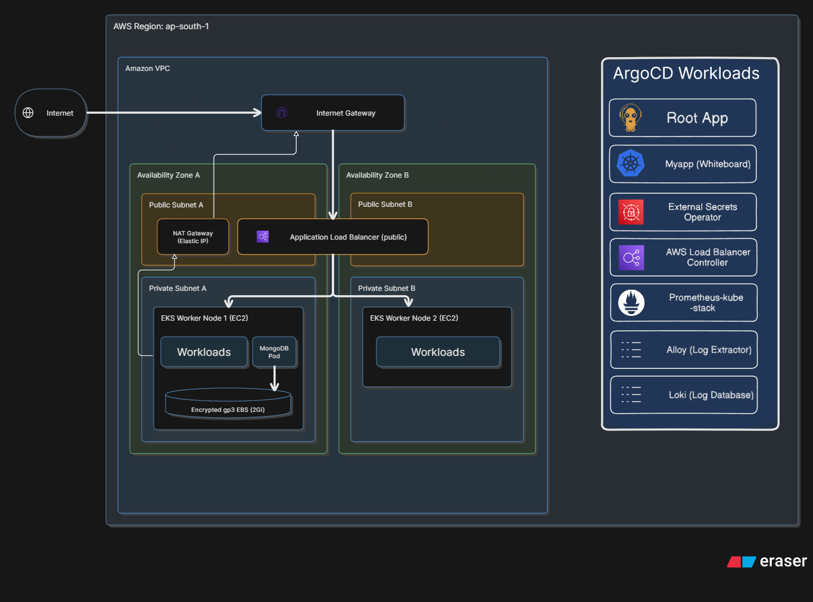

[wb-code](https://github.com/Abhishek3954/Whiteboard) — application and CI/CD  
**wb-infra**  
[wb-manifests](https://github.com/Abhishek3954/wb-manifests) — Kubernetes platform manifests

# AWS infrastructure

Terraform builds the AWS foundation for Whiteboard in `ap-south-1`: a multi-AZ VPC, private EKS cluster, workload identities, secrets, and Argo CD GitOps bootstrap.

<p align="center">
  <a href="https://raw.githubusercontent.com/Abhishek3954/wb-infra/main/docs/aws-infra-diagram.png" target="_blank">
    
  </a>
</p>

## Terraform roots

```text
infra/bootstrap/  S3 state bucket + GitHub Actions OIDC role (local state)
infra/cluster/    VPC + EKS + IAM + secrets + Argo CD (S3 remote state)
```

The bootstrap root creates the encrypted, versioned S3 bucket used by the cluster root. It also creates a GitHub Actions role that uses OIDC and grants the configured repository's `main` branch access to publish images to ECR.

The cluster root provisions:

- A VPC across two availability zones, with public load-balancer subnets and private node subnets.
- A NAT Gateway for private subnet egress.
- An EKS cluster with managed worker nodes and networking, storage, identity, and metrics add-ons.
- EKS Pod Identity roles for External Secrets Operator, AWS Load Balancer Controller, and the EBS CSI driver.
- Generated MongoDB credentials in AWS Secrets Manager.
- Argo CD and a root App-of-Apps application for `wb-manifests`.

## GitOps and secrets

```text
Terraform -> EKS + Argo CD -> wb-manifests -> platform and app workloads
Secrets Manager -> External Secrets Operator -> Kubernetes Secret
```

Terraform configures Argo CD with the manifests repository URL and revision. For a private repository, `gitops_deploy_key_path` points to the local SSH private key Terraform supplies to Argo CD. Its matching public key must be registered as a read-only deploy key in `wb-manifests`.

EKS Pod Identity lets External Secrets Operator read the configured secret from AWS Secrets Manager and sync credentials into Kubernetes. The GitHub Actions OIDC role is separate: it allows CI to publish container images to ECR without long-lived AWS keys.

## Teardown

The cluster root removes Argo CD-managed resources before deleting EKS and the VPC. Its teardown guard waits for ingress load balancers and persistent volumes to be removed. Cluster provisioning and teardown can each take around 15 minutes. The bootstrap state bucket and CI role are separate and remain in place.

## Repository layout

- `infra/bootstrap/` — S3 state bucket and GitHub OIDC role.
- `infra/cluster/` — VPC, EKS, IAM, secrets, Argo CD, teardown guard.
- `infra/cluster/charts/` — vendored Argo CD chart and root App-of-Apps chart.
- [`infra/cluster/terraform.tfvars.example`](infra/cluster/terraform.tfvars.example) — example cluster input values.
- `policies/lbc-policy.json` — AWS Load Balancer Controller IAM policy.
- `docs/aws-infra-diagram.png` — infrastructure diagram.

## Lifecycle

The Architecture is completely reproducible. Once the Terraform backend and variables are configured, creation or destruction of the cluster is as simple as:

```sh
terraform apply
terraform destroy
```
